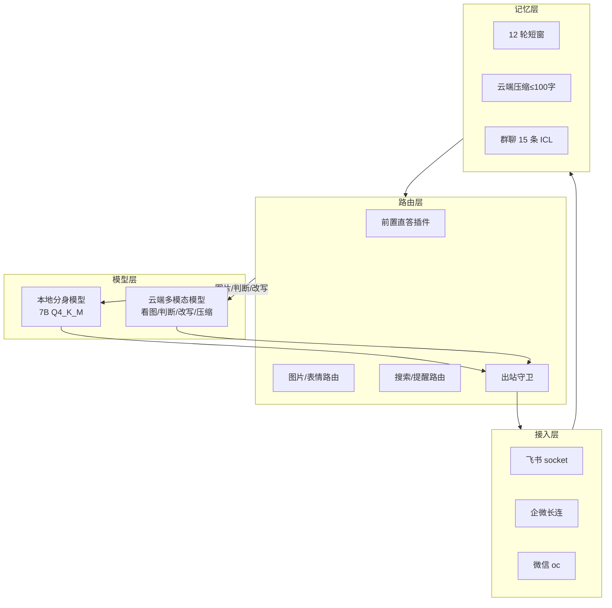

# AI Persona Clone

A complete self-hosted persona agent. A local LLM fine-tuned on my chat history, plus a plugin pipeline that reads images, picks stickers, searches the web, keeps reminders, and guards every outgoing reply.

一个跑通完整闭环的个人 AI 分身智能体。本地微调模型负责说话，插件流水线负责看、查、记、拦。从原始聊天记录到真人可聊的分身,整条链路都在这里。

| 项 | 值 |
|---|---|
| 基座模型 | Qwen2.5-7B-Instruct |
| 微调方式 | QLoRA，rank 64 / alpha 128 / dropout 0.1 / all-linear，nf4 + double quant |
| 训练数据 | 9,815 条，其中真人记录 7,551 + 补造合成 2,264 |
| 训练 | 单卡 4090，1,228 步，1,927 秒，final train loss 2.6136 |
| 量化 | bf16 合并 → f16 GGUF → Q4_K_M，4,683,073,632 字节 |
| 线上部署 | RTX 3080 10GB 全量显存，Ollama 托管，AstrBot 4.29.4 常驻 |
| 对话风格 | 回复中位 11 字，p90 31 字，超 80 字仅 0.7% |
| 人工盲测 | 不出错 91%，精准像人 78% |
| 频道 | 飞书（线上）／企微／微信 oc（通道已接，默认关闭） |

---

## 一、这是什么

不是一个"微调完扔个 demo 就算完"的实验。它是一套分三层的系统，每层都有独立职责，又必须咬合。

**模型层**：用本人真实聊天记录做小数据 SFT，让 7B 学会本人口吻——短句、分行、口语、会怼人。量化到 4.7GB 后，能在 10GB 显卡上全量放显存推理。

**智能体层**：模型只会写字，剩下的都得补。看图、挑表情包、联网查实时信息、算日期、定时提醒、压缩记忆、拦住不该发的内容——全部由 11 个插件按消息链路编排。微调后模型不会调工具，所以工具全部走代码路由，不指望模型自己发起。

**部署层**：Ollama 托管模型，AstrBot 做平台接入和消息分发，systemd 常驻，崩了自动重启。

三层缺一层就不成立。只讲训练，等于只讲了三分之一。

## 二、能力全景

| 能力 | 实现方式 | 层 |
|---|---|---|
| 风格化文字回复 | QLoRA 微调模型，本地 Ollama 推理 | 模型 |
| 看图接话 | 图片回合切多模态视觉模型直答，不看转述文本 | 智能体 |
| 群聊图文合并 | 图片与文字事件分离时，缓存图片引用，文字回合再补进请求 | 智能体 |
| 表情包检索 | 模型读对话情绪，按语义从图库挑图，不用关键词桶 | 智能体 |
| 智能斗图 | 图库自动多维打标，语义匹配连发，支持队形与团战 | 智能体 |
| 主动发图 | 按语境概率性主动挂表情，不必等人要 | 智能体 |
| 实时联网 | 指令直搜 + 判断是否需要搜，Tavily 取资料后用本人风格改写 | 智能体 |
| 定时提醒 | 代码路由解析时间，本地定时兜底，同步写进飞书日历 | 智能体 |
| 时间日期直答 | 命中即读系统时钟，含明天/后天/N 天后运算 | 智能体 |
| 基本资料直答 | 年龄/身高/体重按配置回答，不过模型 | 智能体 |
| 零信息消息兜底 | "在吗""你好""你是谁"直接回固定短句 | 智能体 |
| 预设结论 | 特定比较题锁死结论，措辞交模型改写 | 智能体 |
| 短期记忆 | 12 轮窗口，超 8 轮截断，保留最近 30% | 智能体 |
| 长对话压缩 | 云端模型压成不超过 100 字摘要，只留未解决事项与关键事实 | 智能体 |
| 群聊上下文 | 取最近 15 条群消息，图片先转描述 | 智能体 |
| 主动回复 | 群聊按 0.4 概率主动接话 | 智能体 |
| 出站敏感过滤 | 违禁词替换／删句／整条替换三档 | 智能体 |
| 出站称呼守卫 | 亲密称呼、markdown 残留、超长、重复行双层拦截 | 智能体 |
| 小图卡片 | 飞书表情图转小图，不撑成大图 | 智能体 |
| 候选重排 | 同一输入采 4 条，规则打分择优 | 模型 |
| 多平台 | 飞书 socket／企微长连／微信 oc，同一套逻辑 | 部署 |

## 三、架构



## 四、一次对话发生了什么

1. 消息进来，按平台解析成事件。群聊里图片和文字常是两条独立事件，图片那条先按会话缓存引用（base64 自带数据，带 TTL，不等临时链接）。
2. 前置直答层先扫一遍。"现在几点""明天几号""你多高""在吗""你是谁"命中就直接回，不唤醒模型。零信息短句交给小模型只会乱猜。
3. 图片回合切到多模态视觉模型，把图看明白，再按人设接一句。本地 7B 是纯文本模型，看不见图。
4. 文字回合判断要不要联网。用户明确说"帮我查"就直接搜；其余交云端模型判一次"这问题是否依赖外部事实或实时信息"，判是才搜。
5. 搜索命中后，把结果交给云端模型用自己的口吻改写，不直接甩原文。
6. 提醒请求走代码正则解析时间与内容，挂本地定时任务，同时以本人身份写进飞书日历。写日历需要 OAuth 用户令牌，日程必须带 reminders 字段才会真的响。
7. 常规回合交给本地分身模型生成。同一输入采 4 条，按规则打分择优（长度、开头、分条、与上文的 2-gram 重叠）。
8. 出站前过守卫：先查违禁词，再查亲密称呼、markdown 残留、超长、重复行，两层拦截防止流式绕过。
9. 表情包插件读对话情绪，从图库挑一张贴合的，挂到这条回复后面，跟文字一起发。
10. 发出。若本地模型连续失败 5 次，落到云端模型兜底，不让会话断掉。

## 五、模型层

### 5.1 数据

原始素材是四段会话（私聊与群聊），导出后共 27 万条消息。最终训练集 9,815 条，构成为真人记录 7,551 条、补造合成 2,264 条。

补造不是凑数。真实数据里"接好消息""接倾诉""低频生活场景"样本严重不足，模型在这些场景会突然变客服腔。合成部分专门补这三类。

维度分布（多标签，合计超 100%）：

| 维度 | 占比 | 主样本 |
|---|---|---|
| 日常 | 41.6% | 4,078 |
| 互怼 | 17.9% | 1,753 |
| 玩梗 | 14.3% | 1,402 |
| 询问 | 13.3% | 1,304 |
| 活泼 | 12.9% | 1,262 |
| 情感-正面 | 9.4% | 918 |
| 关心 | 8.0% | 785 |
| 情感-负面 | 3.9% | 383 |

风格统计比维度更能定标：本人回复中位 11 字，p90 31 字，超 80 字仅 0.7%，约 70% 的回复带换行，约 15% 会反问。这组数字后来成了所有长度类判定的基准线。

### 5.2 清洗

十轮，每轮都有具体触发原因，不是流程走场。

1. 全量逐条复读，删病情线，修敏感摘要。
2. 补 550 条情感-正面样本，平衡分布。
3. 真名清洗，姓氏扫描出 504 个候选，两批替换 80 余个真实姓名。
4. 敏感 token 终检，命中 0。
5. 补造接倾诉 103 条、低频场景 87 条、生活琐事 73 条。
6. 全量 1 万余条语义再复读，删 62 条（敏感、同文异答、专业答疑、陌生人事务），改 200 处文本。
7. 收尾：84 条模板化回复改成有热度的说法，合并相邻同角色轮，删 116 条"只剩孤立上文、回复接不上"的行。
8. 第 28 轮冲突审计：同锚点异回复全库扫描，770 组候选逐组人工裁决，删 173 条（纯重复 2、截断短版 161、语义冲突 10）。
9. 定稿 9,815 条，保留行字节级零改动，双文件备份。
10. 全量结构性校验：0 违例、双文件逐行对齐。

三个清洗坑值得单说，都是结构性问题不是数据问题：

**会话分片**。微信把会话拆在多个库里，89 张表名重复。按表分别建轮次，同一段对话会被切成几条独立时间线，上下文像从中段硬切。改成按时间戳合并成一条时间线后，定位率从 40% 升到 99%。

**发送者 ID 是分片内编号**。各分片里本人的 rowid 不同，用全局 ID 会让四个分片的角色整体颠倒，"我的回复"被标成对方。必须逐分片解析本人 ID，再按时间、角色、文本去重合并。

**随机窗口跨话题**。旧逻辑随机回退 1 到 6 轮，不看时间间隔，把两个话题甚至两天的内容拼成一个上下文。这是串味的真正来源。改成在 30 分钟断点处切断、向前补到本次对话起点（≤10 分钟、≤8 轮），内部断点归零。

答非所问的判定不许脚本参与。字面重合规则精确率只有 6%，外部模型判 0 的里面六成是误杀。最后 17,906 条全部由人逐条读"对方末句 → 我的回复"，判出 113 条真错，占 0.63%。

### 5.3 训练

```yaml
base: Qwen/Qwen2.5-7B-Instruct
stage: sft
finetuning_type: lora
quantization_bit: 4          # nf4 + double quant
lora_rank: 64
lora_alpha: 128
lora_dropout: 0.1
lora_target: all
template: qwen
cutoff_len: 2048
num_train_epochs: 2.0
per_device_train_batch_size: 4
gradient_accumulation_steps: 4
learning_rate: 1.0e-4
lr_scheduler_type: cosine
warmup_ratio: 0.1
bf16: true
gradient_checkpointing: true
```

单卡 4090，1,228 步，1,927 秒，final train loss 2.6136。训练不放手写 Trainer，超参全部落在 yaml，由 LLaMA-Factory CLI 执行。

选 7B 不选 3B 是算过显存的：10GB 显存 + 80GB 内存，7B QLoRA 放得下；7B 的 Q4 权重约 4.4GB 能整块进显存；3B 在长句、指令遵循、多轮承接上明显吃亏。

### 5.4 量化

正确路径只有一条：

```
bf16 merged (15.5GB)
  → convert_hf_to_gguf.py --outtype f16
  → llama-quantize Q4_K_M
```

走过的错路：bf16 → q8_0 → Q4_K_M 二次压缩。模型嘴上还像本人，但完全不答问题。问"1+1"，答"大于 2 / 可能等于 2 / 看那两个人"。

排查顺序是排除法：同机跑别的模型正常，排除环境；删掉手写模板，排除模板；补上 system，排除分布外；清显存强制 CPU，排除性能；直测云端 bf16 合并模型五句全对，锁定 GGUF 文件本身。

根因是 `llama-quantize` 从 q8_0 再压到 Q4_K_M 会显著破坏权重。工具本身对 requantize 有限制，要加 `--allow-requantize` 才放行——这个警告本身就是信号，不该绕过。

量化完必须跑两句常识做验收：`1+1` 答 2，`首都在哪` 答北京。答含糊就是文件坏了，别去调 prompt。

### 5.5 评测方法论

这是整个项目里最能迁移的部分。**一个"像本人说话"的模型，不能用知识问答那套去测。**

**第一版：贪心解码误判训练崩溃。** 用 `do_sample=False` 跑 312 条，17 条重复退化，其中一条把"算了"重复 47 次。第一反应是权重坏了。改成采样（temperature 0.7 / top_p 0.9 / rep 1.15 / no_repeat_ngram 3）重跑同一批：

| 指标 | 贪心 | 采样 |
|---|---|---|
| 重复退化 | 17 | 0 |
| 超 80 字 | 19 | 5 |
| 长度中位 | 16 字 | 13 字 |

结论：重复 collapse 是贪心在长句里进了 n-gram 循环，不是权重问题。风格化对话恰恰不能取最高概率——同一句话有很多种说法，强行取最大值反而掉进循环。

**第二版："相同输出"不是过拟合。** 贪心版 31 组、72 条输出完全相同，一度判为背题。查下去是测试集里"好！""好呀""我去"这类 prompt 本身就重复，相同输入给相同输出是必然。采样版降到 6 组 16 条。

真正的背题判据是**照搬率**：拿生成结果比对训练集全部回复，统计 8-gram 命中。12 / 312 = 3.8%，命中内容全是"是的""当然""好好好"这种 7 字以内的习惯用语，整段照搬 0 条。模型学的是说话方式，不是背答案。

**第三版：拆成两个口径。** "好不好"必须拆开，否则永远吵不清。

- 不出错（不答非所问、不串味、不退化、不角色错位）：90 条人工抽样，真错 8 条 → **91%**
- 精准像人（在上面基础上还要求切题、风格到位、长度像本人）→ **78%**

同一个模型两个数差 13 个点。对外报哪个，取决于你想问"能不能用"还是"有多好"。混着报就会自相矛盾。

**维度级盲测**：720 条，9 个维度各 80 条，每维度抽 10 条人工判。

| 维度 | 通过 | 维度 | 通过 |
|---|---|---|---|
| 日常 | 10/10 | 活泼 | 8/10 |
| 情感-负面 | 10/10 | 冷淡 | 7/10 |
| 情感-正面 | 9/10 | 互怼 | 5/10 |
| 询问 | 9/10 | 玩梗 | 4/10 |
| 图片 | 8/10 | | |

这张表比总分有用。它直接指出下一步该补什么：玩梗 4/10、互怼 5/10，样本量本来就最少，且玩梗高度依赖具体语境，模型学不到那个"点"。

**一条失败的路**：为提高互怼玩梗做 2 倍过采样，训练集 9,815 → 13,472，1.5 epoch。train loss 反而更低（2.318 vs 2.614），效果全面变差：碎片开头 14.3% → 18.5%，"稳了"在 720 条里霸榜 30 条，图片维度 9/10 → 5/10，出现 `'url'` 异常 token，人工抽样 61%。模型学到的是"不管问啥先甩一句口头禅"的开头模板。loss 更低不等于更好，风格化任务上尤其明显。

### 5.6 推理增强：best-of-4

同一输入采 4 条候选，规则打分选最高：

```
长度 5-40 字 +2；<5 或 >60 字 -1
开头是 666/我的发/我去/稳了/哈哈/？/。。 -2
含 url 或单引号 -6
分条 1-4 行 +1，>6 行 -1
与 prompt 有中文 2-gram 重叠 +3
prompt ≥10 字且零重叠 -4
长度 ≤3 且 prompt ≥12 字 -2
含 砍死/我恨/去死/杀/打死 -3
```

规则不是拍脑袋，是从训练分布反推：长度区间对应中位 11、p90 31；开头黑名单是采样高频且通常意味着没接住话；2-gram 重叠判断是否真的回应了对方。720 条上比单次采样提升约 3 个点。

## 六、智能体层

模型只会写字。剩下全部靠编排。

### 6.1 双模型分工

| 角色 | 模型 | 职责 |
|---|---|---|
| 主模型 | 本地 7B 分身（Q4_K_M） | 出本人风格的文字回复 |
| 副模型 | 云端多模态 | 看图、判断是否联网、搜索改写、压缩记忆、改写预设结论、主模型失败兜底 |

关键约束：微调后模型的 function calling 能力归零，`tool_calls` 恒为 null。所以所有工具都不指望模型自己发起，一律由插件在钩子里代码路由。这不是退让，是实测后的定案。

### 6.2 插件分工（11 个）

| 插件 | 职责 | 关键机制 |
|---|---|---|
| 时间日期直答 | 几点、几号、星期几、明天/后天/N 天后 | 读系统时钟，含相对日期运算 |
| 基本资料直答 | 年龄、身高、体重 | 按配置回答，不进模型 |
| 短问候兜底 | 在吗、你好、你是谁 | 固定短句，命中即终止事件 |
| 预设结论 | 特定比较题 | 生成前注入约束，生成后不由模型改写 |
| 图片路由 | 图片回合 | 切视觉模型，附人设提示，禁止"看不懂" |
| 群聊图片缓存 | 群聊图文分离 | base64 缓存 + TTL，文字回合补图并预选视觉模型 |
| 图片对话中枢 | 图库管理与斗图 | 自动多维打标、语义检索、连发、WebUI 管理、多源导入 |
| 表情选择 | 主动发表情 | 模型判情绪，语义挑图，挂到回复后 |
| 飞书小图卡片 | 表情图显示 | 转小图卡片，避免撑成大图 |
| 搜索与提醒 | 联网 + 定时提醒 | 两级路由、Tavily、飞书日历 OAuth、按发送者隔离 |
| 违禁词过滤 | 出站文字 | 替换/删句/整条替换三档，词表在配置里 |
| 回复守卫 | 出站兜底 | 亲密称呼、markdown 残留、超长、重复行，双层拦截 |

（表中两项属同一插件的子能力，实际共 11 个插件。）

### 6.3 搜索路由

两级：

1. 用户明确下指令——"搜一下""帮我查""百度一下"——正则命中，跳过判断直接搜，零延迟。
2. 其余消息交云端模型判一次"这问题是否依赖外部事实或实时信息才答得准"，判是才搜，判否退回分身模型。

判断超时从 2.5 秒一路放宽到 10 秒。原因是中转接口常态 4.9–5.4 秒，2.5 秒会把闲聊全判成超时然后不搜，表现为"功能时好时坏"。

早期版本按类目白名单准入，只搜天气、美食、新闻，概念、人物、公司、技术类问题永远搜不到。后来删掉白名单，改成按"是否需要外部事实"判断，覆盖面才正常。回答模板也按话题分流：天气走关心话术，其余走通用模板。

搜索结果不直甩原文，交云端模型用自己的口吻改写。另有一层正则清理，防 `<tool_calls>` 这种调用语法被当文字发出去。

### 6.4 提醒链路

提醒不依赖模型理解，走代码正则解析：识别"提醒我""记得叫我""到点喊我"等触发词，剥掉时间词与指令词，剩下的就是内容。时间解析支持"3 分钟后""明天早上 8 点""下午五点"。

落到三处保证不丢：

- 本地账本 `reminders.json`，重启后按未到点重新挂定时任务。
- 本地异步定时，到点私聊推送。拼不出私聊会话就拒绝创建，绝不把别人的提醒播到群里。
- 飞书日历，以本人身份（OAuth user_access_token）写入本人主日历。应用身份只能写应用私有日历，用户在自己 App 里看不见，所以必须先授权一次。日程必须带 `reminders: [{minutes: 0}]`，否则是条"死日程"——日历里看得见，到点一声不吭。

写操作按发送者隔离，每人提醒上限 5 条。取消提醒时本地账本与日历日程一起删。

### 6.5 记忆与上下文

- 短期窗口 12 轮，超 8 轮截断，保留最近 30%。
- 旧对话交云端模型压成不超过 100 字摘要，指令明确：只记未解决的事、关键事实、我的态度倾向；不记已聊完的话题，不引原话，不写"之前聊过"。
- 群聊 ICL 取最近 15 条，图片先转文字描述再进上下文。
- 群聊主动回复按 0.4 概率接话。

压缩规则是踩坑来的。窗口给到 24 轮时，模型开始复读旧话题；缩到 8 轮又丢上下文。最终 12 轮 + 精简摘要，复读消失且承接不断。

### 6.6 出站守卫

两层，因为流式输出可能绕过第一层：

1. `on_llm_response`：模型刚生成完，改结果。
2. `on_decorating_result`：发送前最后一步，再洗一次。

规则：命中亲密称呼或性暗示类词，整条换成兜底短句，不删行——整句都违规时删完就空了，而且流式下第一层根本没走到。命中 markdown、todo、英文占位残留，删掉那一行。超过行数上限截断。连续重复或包含关系的行去重。

敏感提示词长度也踩过坑：每轮注入 112 字负面清单，模型变呆变机械。缩到 18 字"别主动开黄腔，对方没提就别往性上扯"，自然度立刻回来。短提示比长清单有效。

### 6.7 平台适配

飞书是线上主力，socket 长连。企微和微信 oc 通道都已接好，默认关闭。同一套逻辑换平台只需换适配层。

飞书的两个坑：群聊把图片和文字拆成两条事件，纯文本模型只看得到 `[Image]` 占位；表情图默认渲染成大图。前者用群聊图片缓存插件补，后者用小图卡片插件转。

## 七、部署

### 7.1 模型服务

Ollama 托管，systemd 自启。`Modelfile` 关键点：

```
TEMPLATE "{{ if .System }}<|im_start|>system\n{{ .System }}<|im_end|>\n{{ end }}<|im_start|>user\n{{ .Prompt }}<|im_end|>\n<|im_start|>assistant\n"
PARAMETER temperature 0.7
PARAMETER top_p 0.9
PARAMETER repeat_penalty 1.15
PARAMETER num_predict 64
PARAMETER num_ctx 2048
PARAMETER stop <|im_end|>
```

TEMPLATE 必须显式声明对话格式。某些路径会把 `<|im_start|>` 当普通文字塞进 prompt，模型看到变形的对话结构，输出就成"?????"或乱码。判据：问一句常识，答对说明格式走通了。

SYSTEM 处理有个细节：训练数据里没有 system 字段，但 Ollama 对无 system 的对话会自动注入"You are Qwen, created by Alibaba Cloud..."，这是训练时从未见过的输入，属于分布外。所以要么模板判空不注入，要么显式给一句短 system，两者不能混。

### 7.2 常驻

AstrBot 由 systemd 托管，崩溃 5 秒后自动重启。工作目录、Python 环境、日志都固定。面板端口对外，想收紧改成只监听本地。

关键一条：客户端侧 system 要留空或只留一句。框架会带几百字自己的人设提示，一旦客户端传了 system，模型文件里的 SYSTEM 直接被忽略，几百字训练分布外的强干扰会把微调结果毁掉。温度、top_p、max_tokens 也要和模型侧对齐，别让两处打架。上下文别超过训练时的 2048。

### 7.3 双环境实测

| 环境 | 显存 | 策略 | 表现 |
|---|---|---|---|
| RTX 3080 | 10GB | 全量放显存 | 主力部署，长回复稳定 |
| RTX 3050 Ti Laptop | 4GB | 部分层卸载到 CPU | 约 16 tok/s，能跑，慢 |

4GB 那台是兼容性下限验证，不是生产环境。

## 八、仓库边界

这个仓库开源的是**模型层与评测方法论**，不是全系统。

```
ai-persona-clone/
├── README.md
├── Modelfile                     # 本地推理参数
├── configs/
│   ├── train_qlora.yaml          # LLaMA-Factory 训练配置
│   └── dataset_info.json         # 数据集注册表
├── src/
│   ├── build_dataset.py          # ShareGPT 构造（脱敏骨架）
│   ├── eval_sampled.py           # 采样评测：退化/超长/照搬率
│   └── best_of_n.py              # 候选重排打分器
├── scripts/
│   ├── train.sh                  # 训练入口
│   ├── merge_lora.sh             # 合并 adapter
│   └── convert_quantize.sh       # f16 → Q4_K_M
├── samples/
│   ├── sample_train.json         # 10 条最小格式示例
│   ├── demo_train.json           # 51 条合成对话，可跑通全流程
│   └── demo_dialog.md            # 脱敏对话样例
└── docs/
    ├── evaluation.md             # 评测方法论完整记录
    └── troubleshooting.md        # 量化/模板/system 踩坑
```

几点要说清：

- `build_dataset.py` 是骨架示例。真实清洗链条（分片合并、轮次对齐、逐条语义审计、冲突裁决）没开源，脚本里姓名映射字典留空。照着骨架跑不出 78% / 91% 这两个数字。
- `demo_train.json` 是 51 条合成对话，覆盖 9 个维度，用来验证代码链路，不代表真实分布。
- **插件实现不在本仓库**。11 个插件的代码、图库、平台配置、真实数据、模型权重都不发布。README 第六节写清了每个插件的职责与机制，是设计说明，不是源码。
- 想自己搭：导出聊天记录 → 清洗 → 打标 → QLoRA → 合并量化 → Ollama → 按第六节把插件补齐。数据量 8,000 条以上效果才稳，少于 3,000 条容易过拟合到具体事件。

## 九、复现

```bash
# 0. 环境
pip install "llamafactory[metrics]>=0.9.5"

# 1. 训练（一张 24GB 以上显卡，7B + 4bit）
bash scripts/train.sh
# 等价于 llamafactory-cli train configs/train_qlora.yaml

# 2. 合并
BASE_MODEL=Qwen/Qwen2.5-7B-Instruct ADAPTER=saves/qwen25-7b-lora bash scripts/merge_lora.sh

# 3. 量化（f16 直转，不要经 q8）
bash scripts/convert_quantize.sh

# 4. 本地跑
ollama create mypersona -f Modelfile
ollama run mypersona
```

单独跑评测与重排：

```bash
python src/eval_sampled.py --adapter saves/qwen25-7b-lora \
    --input data/eval.jsonl --train samples/demo_train.json --output out/eval.json

python src/best_of_n.py --adapter saves/qwen25-7b-lora \
    --input data/eval.jsonl --output out/best4.json --n 4
```

`configs/dataset_info.json` 把 `demo_train.json` 注册成 `persona_train`，yaml 里的 `dataset: persona_train` 才找得到。`train.sh` 会自动把注册表复制到数据集目录。

## 十、踩坑清单

完整记录见 `docs/troubleshooting.md`，这里只列结论：

1. q8_0 二次压到 Q4_K_M 会毁权重，必须 f16 直转。
2. 本地工具不认 `<|im_start|>` 为特殊 token，要显式 TEMPLATE。
3. 训练无 system、推理被自动注入，属于分布外，必须固定一侧。
4. 客户端长 system 会压过模型侧 SYSTEM，毁掉微调结果。
5. 过采样升维度反而让模型学会模板化开头，loss 更低不等于更好。
6. 贪心解码测风格化对话必然误判，用采样。
7. 照搬率要用 8-gram 命中测，不能用"两条输出一样"。
8. 微调后 function calling 归零，工具必须代码路由。
9. 大文件跨机传输别开并发，服务端只放行一条连接，单流 + 断点续传 + MD5 校验。
10. 改配置要先停服务，运行中改会被内存配置覆盖。

## 十一、隐私与数据

**仓库不含任何真实聊天记录、模型权重、插件源码、平台凭据。**

- `sample_train.json` 10 条、`demo_train.json` 51 条，全部虚构，人名事件场景不对应任何真人。
- 真实数据 9,815 条涉及他人隐私，不公开、不分享、不上传。
- `.gitignore` 兜底排除模型权重、原始数据库、密钥、身份令牌、平台配置。
- 使用时请注意：聊天记录包含对方的消息，收集与使用需符合当地法律并取得授权；分身与他人对话时建议标明是 AI，避免对方误以为在跟真人交流；模型输出可能不准确，不代表本人观点。

## 十二、现状与后续

已经跑通的：风格模型、量化部署、飞书接入、看图、表情包、联网、提醒、记忆、出站守卫，线上常驻。

明确的短板：

- 玩梗 4/10、互怼 5/10。样本量少，且玩梗依赖具体语境，这是数据问题不是训练问题。
- 当前模型先验偏忍让，"被骂直接回怼"提示词压不住，只能靠补数据。
- 训练窗口 2048 偏小，放 4096 需要更多显存；上 14B 时该重新权衡。
- 搜索判断依赖云端中转接口，单次约 5 秒，闲聊回合有几秒延迟。必要时应换更快的判断源或对明显闲聊前置跳过。

要做的方向：补互怼与玩梗样本、长对话 30 轮纳入常规评测、把插件中通用部分脱敏后单独开源。

## License

MIT
